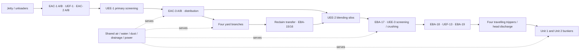

# Design contract

## The experience being built

Opening the model should tell a coherent story: **where coal comes from → what this equipment does → what it contains → what drives and protects it → where coal goes next**. The opening scene is an intelligible machine or place. Clicking reveals assemblies; selecting a part opens its details and evidence without losing the scene.

Keep the accepted visual-first interface. Do not rebuild the model as rows of “purpose / location / auxiliaries / facts” cards. Tables are appropriate inside a selected component's detailed inspection, source comparison or engineering review, not as the primary equipment experience.

## Four related structures, one identity per asset

| Structure | Answers | Implementation rule |
|---|---|---|
| Process route | What feeds this, and where can it discharge? | Directed, conditional material edges. A branch selector must preserve its conditions. |
| Equipment assembly | What is this made of? | Accepted `part_of` edges from component to assembly. Descriptive untagged groups are allowed with evidence. |
| Place | Where is it, and what else is here? | `located_at`, source-backed endpoints/elevations and nearby services. Do not duplicate assets to populate a building. |
| Supporting networks | What drives, supplies, senses or controls it? | Mechanical, utility, electrical and control edges kept distinct from material flow and ownership. |

For example, the EAC-1A drive remains part of EAC-1A and is located at UEF-1. Its oil pump belongs to the coupling oil circuit. UEF-1 exposes those assets in its scene without owning a duplicate drive. A shared DFDS pump stays under the shared system and appears as a service connection at every supported local branch.

Functional areas such as Coal Yard 2 are useful descriptive navigation roots. Establish their membership using the flow/layout source; do not present the label as a fabricated field tag. Existing broad `part_of` edges to the whole plant may coexist with more specific membership. Prefer the nearest supported parent for navigation; review redundancy separately rather than deleting history merely to make a perfect single-parent tree.

## Plant structure to preserve and enrich

This is a conceptual navigation map. It does not select a valid simultaneous operating route or specify isolation.

| Yard | Stacking input | Machine / pile / machine | Reclaim output | Drive / tail houses | Shed | Boundary TPs |
|---|---|---|---|---|---|---|
| 1 | EAC-7 | EAD-1 → EAE-1 → EAF-1 | EBA-8 | UAX-1 / UAX-5 | UEB-1 | UEF-6 / UEF-11 |
| 2 | EAC-9 | EAD-2 → EAE-2 → EAF-2 | EBA-10 | UAX-2 / UAX-6 | UEB-2 | UEF-5 / UEF-10 |
| 3 | EAC-11 | EAD-3 → EAE-3 → EAF-3 | EBA-12 | UAX-3 / UAX-7 | UEB-3 | UEF-4 / UEF-9 |
| 4 | EAC-13 | EAD-4 → EAE-4 → EAF-4 | EBA-14 | UAX-4 / UAX-8 | UEB-4 | UEF-3 / UEF-8 |

Basis: accepted coal-flow topology, control document `doc_4f2cd96c3b1e413ea4b5`, PDF p55, drawing 175001 Rev 8. UAX labels are place identities; inspect the local GAs before asserting which particular head/tail/drive component sits in each house.

## Scene grammar

| Scene | Opening composition | Click path | Boundary always visible |
|---|---|---|---|
| Conveyor | Tail/receiving end, belt carrying/return runs, head/discharge end, attached drive and take-up; compact protection strip | Drive → motor / coupling → oil circuit → pump, cooler or sensor | Incoming/outgoing equipment and the places occupied by its ends |
| Transfer point | Building cutaway, incoming conveyor head, falling chute/branch, receiving conveyor tail, local dust zones and sump | Chute → application point → FAS/PRU/header/nozzle group; drive opens its owning conveyor | Stream labels and each alternative outlet |
| Yard | Parallel stacking and reclaim lanes, stacker, pile, portal reclaimer, shed, local SPDS and drainage | Machine → motion assembly → drive/lube/hydraulic unit | Incoming stacking TP, outgoing reclaim TP and common utility supply |
| Silo house | Both vessels, correct incoming crossover, extraction below each silo, feeders and outlet selectors | Extractor → blade/cone/slew/drive/lubrication; silo → level/access interfaces | EBA-6/16 upstream, EBA-17 downstream |
| Crusher house | Two distinguishable lanes with direct bypass, grizzly split, crusher and collection feeder | Crusher → rotor/drive/door/lube/protection; dust pickup → DE branch | EBA-17 inlet and EBA-18 outlets |
| Tripper / bunker | Rail-mounted tripper on EBA-19, through and side discharge, sealing belt, bunker positions and terminal head discharge | Tripper → travel drive / clamp / limit; bunker → vessel / inlet / dust vent / level | Conveyor stream and unit/bunker assignment |
| Shared utility | Source, duty/standby group, treatment, headers and served branches | Pump/compressor → local components → instrument or consumer | Every served place; single owner of common assets |

Geometry is illustrative unless an explicit source establishes a dimension or relative placement. Use layout anchors such as head-end, tail-end, receiving chute, upper platform and lower floor when supported. A dimension remains a fact with datum and source; do not infer global coordinates from schematic proximity.

Animation should explain documented movement or flow only. It must stop/pause and respect reduced motion. No red/green live-state implication. A reversible conveyor or selectable gate needs a mode-specific illustration; mutually exclusive branches must not animate as simultaneously operating. Missing assemblies remain visibly incomplete, without fabricated motors, nozzles or instruments filling the scene.

## Information disclosure

At first view show identity/tag, one-sentence purpose, placement breadcrumb, recognisable assemblies, source-qualified key capacity if available, and upstream/downstream interfaces. Show a concise unresolved-configuration indicator where it materially changes interpretation.

On part selection show its role, parent/place, compact ratings, support/control connections and an evidence button for **each individual fact and relation**. Expand full specifications, protection conditions, source comparisons and maintenance history only when requested. Keep source close/return at the same selected part and zoom context.

Design ratings, calculated selections, vendor-family data, approved setpoints and dated observations are different kinds of information. Display their basis next to the value. A family calculation can be useful without becoming an installed specification. Do not turn source-stated logic into an operator instruction to bypass a protection.

## Source and control contract

A usable control claim identifies **initiator, condition/polarity, mode, threshold and unit if stated, delay, target action, reset behaviour and applicability**. Omit nothing from a negative condition or an OR/AND clause. If the action is only “trip motor” and the target is unclear, retain that uncertainty at the affected component. Source ambiguity never authorizes a guessed action.

Each source support records immutable document ID/hash, one-based PDF page, printed sheet where different, exact quote or normalized region, source revision/status, and applicability basis. Drawings labelled approved or imported with “as-built” metadata do not by themselves establish installed acceptance. Page-wide regions may support a broad topology; new detailed counts or specifications require a readable local crop including headings, units and applicable row/column.

## Implementation boundary

Reuse `dist/plant-model.js`, `dist/plant-scene-model.js`, `dist/plant-scene.js`, `dist/plant-scene.css` and the existing evidence viewer. Most work is canonical enrichment, applicability and placement; extend a reusable scene template only where the family cannot yet tell its story. Never add a second hardcoded graph containing the extracted plant facts.

The current scene layer supports material/mechanical/utility/control views. The model schema also supports electrical connections, but the accepted projection has **zero documented electrical edges** at this snapshot. P15 must examine the SLD/feeder evidence before adding them; a voltage specification is not an electrical supply connection.

Keep uncertain/generic/off-project material discoverable in a separate reference or review context. Correct classification and applicability through the normal versioned mechanism. Do not force every one of the 600 unplaced records onto the operating map.
